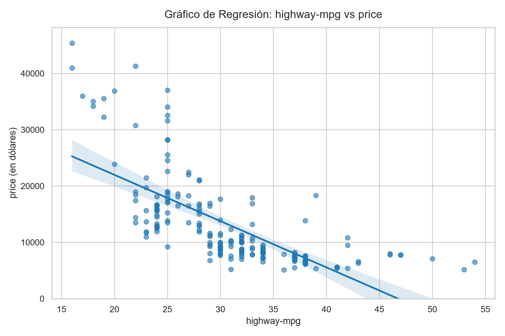
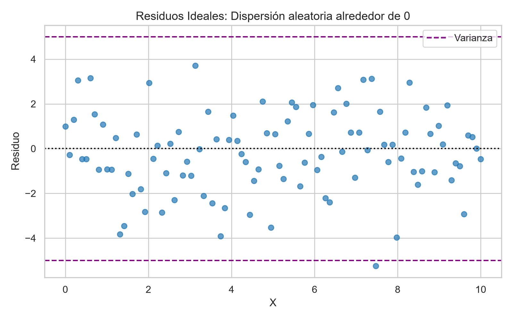
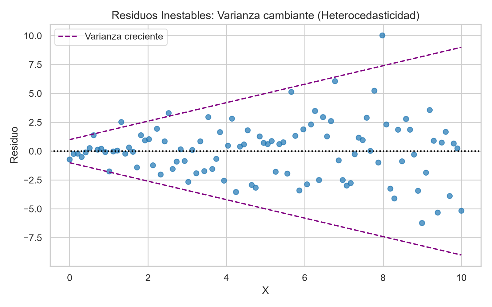
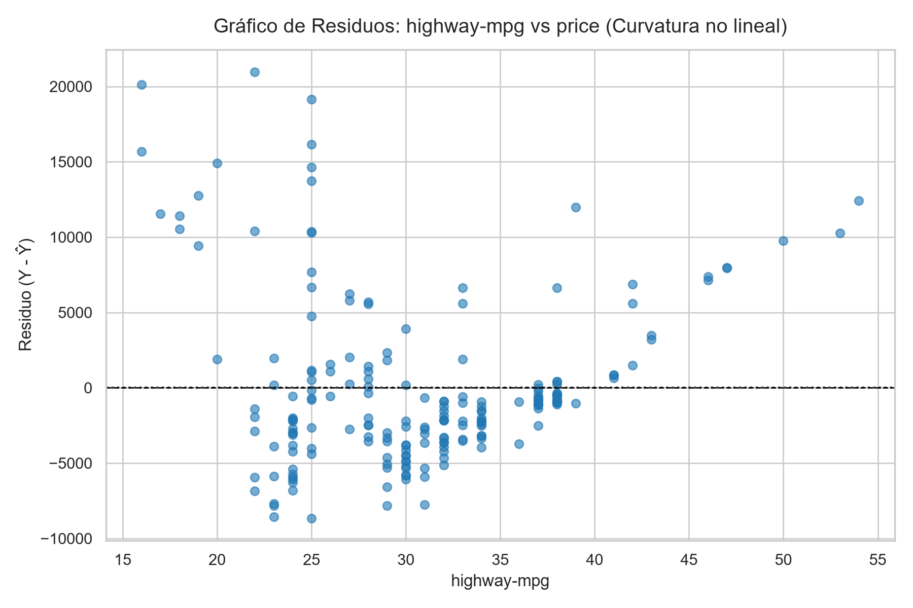
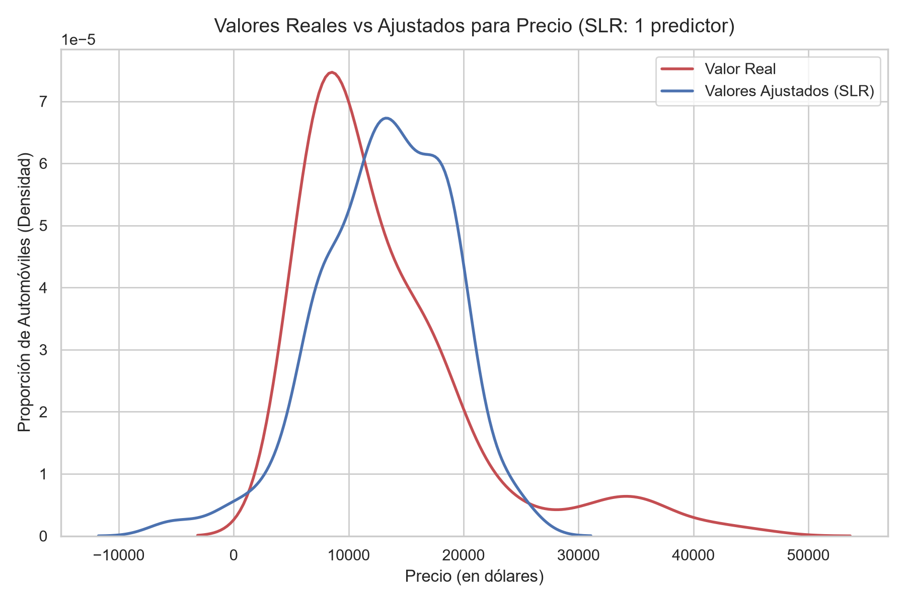
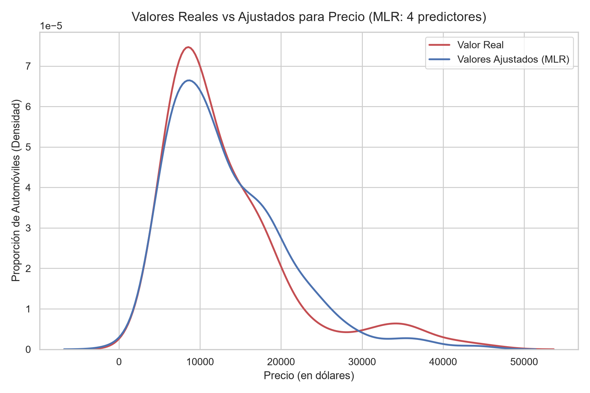
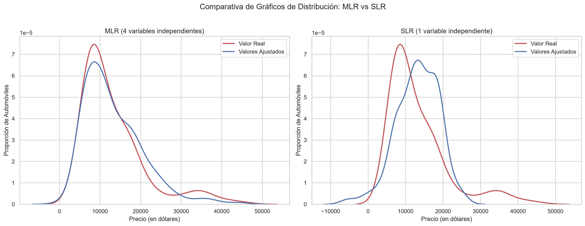

# Evaluación de Modelos Mediante Visualización

La visualización es una de las herramientas más intuitivas y potentes para evaluar el rendimiento de un modelo de regresión. Nos permite inspeccionar la calidad del ajuste, comprobar si los supuestos lineales se cumplen y detectar problemas estructurales (como no linealidades o varianza no constante) antes de recurrir a métricas numéricas complejas.

---

## 1. Gráfico de Regresión (Regression Plot)

El gráfico de regresión combina dos elementos en un mismo plano:
1. **Diagrama de dispersión (Scatter Plot):** Donde cada punto representa una muestra real observada con sus valores $(X, Y)$.
2. **Línea de regresión ajustada ($\hat{Y}$):** La recta estimada por el modelo, típicamente acompañada de un intervalo de confianza sombreado.

### Utilidad del Gráfico de Regresión
- **Fuerza de la correlación:** Evalúa qué tan agrupados están los puntos respecto a la recta.
- **Dirección de la relación:** Determina si la pendiente es positiva (ascendente) o negativa (descendente).
- **Adecuación lineal preliminar:** Permite identificar a simple vista si los puntos parecen seguir un comportamiento recto o si presentan curvaturas evidentes.

### Implementación en Python con Seaborn (`regplot`)

```python
import matplotlib.pyplot as plt
import seaborn as sns

# Gráfico de regresión para analizar la relación entre highway-mpg y precio
sns.regplot(x="highway-mpg", y="price", data=df)
plt.ylim(0,)  # Opcional: fijar el límite inferior en 0
plt.show()
```



- **Parámetro `x`:** Nombre de la columna con la variable independiente (predictor).
- **Parámetro `y`:** Nombre de la columna con la variable dependiente (objetivo / target).
- **Parámetro `data`:** DataFrame de Pandas que contiene las variables.

---

## 2. Gráfico de Residuos (Residual Plot)

Un **residuo** es la diferencia o error entre el valor real observado ($Y$) y el valor predicho por el modelo ($\hat{Y}$):

$$\text{Residuo} = Y - \hat{Y}$$

El **Gráfico de Residuos** traza:
- **Eje horizontal ($X$):** La variable independiente (o los valores ajustados $\hat{Y}$).
- **Eje vertical ($Y$):** Los residuos ($Y - \hat{Y}$).

### Interpretación del Comportamiento de los Residuos

Al analizar la dispersión de los puntos respecto a la línea horizontal central (cero), se pueden presentar tres escenarios fundamentales:

| Tipo de Distribución | Comportamiento Visual | Diagnóstico del Modelo |
|---|---|---|
| **Dispersión Aleatoria Homogénea** | Puntos repartidos al azar alrededor del 0, con media cero y varianza similar en todo el eje X. Sin patrones ni curvas. | **Modelo Lineal Apropiado:** Los supuestos de regresión lineal se cumplen adecuadamente. |
| **Presencia de Curvatura (Patrón No Lineal)** | Los residuos forman una curva (por ejemplo, forma de U o parábola): errores positivos al inicio y al final, y negativos en el centro. | **Modelo No Lineal Requerido:** La hipótesis lineal es incorrecta. Se sugiere transformar variables o usar regresión polinómica. |
| **Varianza Cambiante (Heterocedasticidad)** | Los residuos se abren en abanico (la dispersión/varianza aumenta o disminuye conforme avanza $X$). | **Modelo Incorrecto / Inestable:** La varianza del error no es constante; las predicciones para valores altos de $X$ serán significativamente menos confiables. |

#### Casos Visuales de Diagnóstico de Residuos:

- **Escenario Ideal (Homocedasticidad):**


- **Escenario con Varianza Cambiante (Heterocedasticidad):**


---

## 3. Implementación de Gráficos de Residuos en Python (`residplot`)

Seaborn ofrece la función especializada `residplot()` para trazar y diagnosticar los errores:

```python
import matplotlib.pyplot as plt
import seaborn as sns

# Gráfico de residuos para evaluar highway-mpg frente a precio
sns.residplot(x=df['highway-mpg'], y=df['price'])
plt.show()
```



- **Observación en el dataset de automóviles:** Al graficar los residuos de `highway-mpg` frente a `price`, los puntos no quedan repartidos aleatoriamente alrededor del cero, sino que describen una **curvatura visible** (patrón en forma de U / parábola).
- **Conclusión técnica:** La suposición lineal no es completamente adecuada para este predictor individual; los datos sugieren una relación no lineal o la necesidad de incorporar términos de orden superior (regresión polinómica).

---

## 4. Gráficos de Distribución (Distribution Plots)

Cuando construimos modelos con **más de una variable independiente (MLR)**, ya no es posible visualizar el ajuste con un gráfico de dispersión bidimensional convencional. En estos casos, el **Gráfico de Distribución** es la herramienta por excelencia para comparar:
- **Valores Reales ($Y$):** La distribución observada de la variable objetivo (en color **rojo**).
- **Valores Ajustados / Predichos ($\hat{Y}$):** La distribución calculada por el modelo (en color **azul**).

### De Histograma a Función de Densidad
1. Un histograma agrupa datos en contenedores discretos según su frecuencia de aparición.
2. Dado que los precios reales y predichos son variables continuas, Seaborn ajusta una curva suavizada de **densidad de probabilidad** (KDE - *Kernel Density Estimation*).
3. El eje vertical se escala de manera que el **área total bajo cada curva de distribución sea igual a 1**, permitiendo una comparación directa de formas y dispersiones relativas.

### Comparación Diagnóstica: SLR frente a MLR

#### 1. Modelo Lineal Simple (SLR - Un solo predictor)
- En el rango de precios comunes (\$10,000 a \$20,000), las curvas se aproximan razonablemente.
- En los extremos y en precios elevados (\$40,000 a \$50,000), el modelo simple es inexacto: predice de forma deficiente la concentración real de vehículos de alto valor.



#### 2. Modelo Lineal Múltiple (MLR - Cuatro predictores)
Al comparar las distribuciones lado a lado:
- La curva azul (valores predichos) se superpone con notable mayor fidelidad sobre la curva roja (valores reales), tanto en el pico central como en las caídas laterales.
- Al incorporar más información relevante (`horsepower`, `curb-weight`, `engine-size`, `highway-mpg`), el modelo captura mucho mejor la verdadera distribución del mercado.



#### Comparativa Lado a Lado (MLR vs SLR):


---

## 5. Implementación de Gráficos de Distribución en Python (`kdeplot`)

Para trazar la comparación de densidades en un mismo gráfico, utilizamos la función `kdeplot()` de Seaborn:

```python
import matplotlib.pyplot as plt
import seaborn as sns

# 1. Trazar la distribución de los valores reales (Y) en color rojo
ax1 = sns.kdeplot(data=df['price'], color="r", label="Actual Value")

# 2. Superponer la distribución de los valores predichos (Yhat) en color azul en el mismo eje
sns.kdeplot(data=Yhat, color="b", label="Fitted Values", ax=ax1)

# 3. Configuración estética adicional del gráfico
plt.title("Actual vs Fitted Values for Price")
plt.xlabel("Price (in dollars)")
plt.ylabel("Proportion of Cars")
plt.legend()
plt.show()
```

### Desglose de Parámetros:
- **`data`:** Conjunto de datos a graficar. Para el valor real pasamos la serie `df['price']`; para el valor ajustado pasamos el arreglo con las predicciones del modelo `Yhat`.
- **`color="r"` y `color="b"`:** Asigna rojo (*red*) para los valores reales y azul (*blue*) para los valores ajustados del modelo.
- **`label`:** Texto descriptivo para la leyenda (`"Actual Value"` y `"Fitted Values"`).
- **`ax=ax1`:** Parámetro crítico que indica a Seaborn dibujar la segunda curva dentro del **mismo objeto de ejes (`ax1`)** donde se graficó la primera curva, permitiendo su superposición e inspección comparativa directa.


