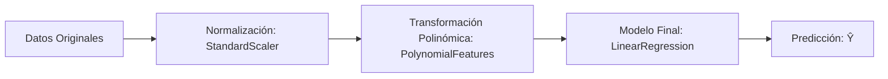

# Regresión Polinómica y Tuberías (Pipelines)

Cuando una relación entre las variables no es puramente recta y los gráficos de residuos muestran patrones curvilíneos, un modelo lineal simple no es suficiente. En estos escenarios se recurre a la **Regresión Polinómica** para capturar curvaturas complejas transformando las características originales en términos de orden superior.

---

## 1. Fundamentos de la Regresión Polinómica

La **regresión polinómica** es un caso particular de la regresión lineal general. 
- Transforma los datos de las variables predictoras elevándolas a diferentes potencias ($X^2, X^3, \dots, X^n$).
- Aunque la función geométrica resultante respecto a $X$ es curva (**relación curvilínea**), **la relación matemática respecto a los parámetros ($b_0, b_1, b_2, \dots$) sigue siendo lineal**, por lo que se pueden seguir usando métodos de ajuste lineal por mínimos cuadrados.

### Tipos de Modelos Polinómicos según su Grado

#### 1. Cuadrático (Segundo Orden - Grado 2)
Modela curvaturas simples en forma de parábola:

$$\hat{Y} = b_0 + b_1 X_1 + b_2 (X_1)^2$$

#### 2. Cúbico (Tercer Orden - Grado 3)
Permite modelar una curva con puntos de inflexión y mayor variación:

$$\hat{Y} = b_0 + b_1 X_1 + b_2 (X_1)^2 + b_3 (X_1)^3$$

#### 3. Orden Superior (Grado $n$)
Para comportamientos oscilatorios o variaciones más pronunciadas:

$$\hat{Y} = b_0 + b_1 X_1 + b_2 (X_1)^2 + b_3 (X_1)^3 + \dots + b_n (X_1)^n$$

*Nota técnica:* Elegir el grado adecuado es crucial. Un grado muy bajo no captura la curvatura (subajuste o *underfitting*), mientras que un grado excesivamente alto puede memorizar el ruido de los datos (sobreajuste o *overfitting*).

---

## 2. Ajuste con NumPy: Diferencia entre `polyfit` y `poly1d`

Para problemas de **una sola variable independiente ($X$)**, la biblioteca NumPy ofrece dos funciones complementarias indispensables:

### ¿Qué hace `np.polyfit`?
- **Función:** Realiza el cálculo matemático de ajuste por mínimos cuadrados (*least squares polynomial fit*).
- **Parámetros:** Toma la variable independiente `x`, la variable objetivo `y`, y el grado deseado del polinomio `n`:
  ```python
  f = np.polyfit(x, y, 3)
  ```
- **Salida:** Devuelve un **arreglo (array) con los coeficientes matemáticos** del polinomio ordenados desde la potencia más alta hasta la constante $[b_n, b_{n-1}, \dots, b_1, b_0]$.

### ¿Qué hace `np.poly1d`?
- **Función:** Toma el arreglo de coeficientes generado por `polyfit` y construye un **objeto función polinómica unidimensional**.
- **Ventajas:**
  1. **Visualización simbólica:** Al imprimirlo con `print(p)`, formatea la ecuación completa de manera legible en texto.
  2. **Evaluación directa:** Se puede invocar como una función de Python para predecir valores: `p(x_nuevo)`.

```python
import numpy as np

# 1. Calcular coeficientes del polinomio de 3er orden
f = np.polyfit(x, y, 3)

# 2. Construir la función polinómica para imprimir y evaluar
p = np.poly1d(f)

# 3. Imprimir el modelo resultante
print(p)
```

#### Salida del Ejemplo con Datos de Automóviles:

$$-1.557(X_1)^3 + 204.8(X_1)^2 + 8965 X_1 + 1.37 \times 10^5$$

---

## 3. Regresión Polinómica Multidimensional

Cuando disponemos de **dos o más variables predictoras** ($X_1, X_2$), la expresión matemática no solo incluye potencias individuales, sino también los productos cruzados o términos de interacción entre ellas:

$$\hat{Y} = b_0 + b_1 X_1 + b_2 X_2 + b_3 X_1 X_2 + b_4 (X_1)^2 + b_5 (X_2)^2 + \dots$$

### Limitación de NumPy
- La función `np.polyfit()` de NumPy está diseñada exclusivamente para **una sola dimensión**. No puede ajustar polinomios multidimensionales.

### Solución con Scikit-Learn: `PolynomialFeatures`
Para trabajar con múltiples predictores, utilizamos el módulo de preprocesamiento de Scikit-Learn:

```python
from sklearn.preprocessing import PolynomialFeatures

# 1. Crear el transformador indicando el grado del polinomio
pr = PolynomialFeatures(degree=2, include_bias=False)

# 2. Ajustar y transformar las características originales con fit_transform
x_polly = pr.fit_transform(x[['horsepower', 'curb-weight']])
```

- **`degree=2`:** Especifica el grado máximo de los términos polinómicos y de interacción.
- **`include_bias=False`:** Evita generar una columna inicial constante de unos ($1$), ya que el estimador `LinearRegression()` de Scikit-Learn calcula automáticamente la intersección ($b_0$).

### Ejemplo Intuitivo de Transformación Matricial

Imaginemos una muestra con dos variables originales: $X_1 = 1$ y $X_2 = 2$.

| Estado | $X_1$ | $X_2$ | $X_1 X_2$ (Interacción) | $(X_1)^2$ | $(X_2)^2$ |
|---|---|---|---|---|---|
| **Original** | 1 | 2 | *(no existe)* | *(no existe)* | *(no existe)* |
| **Transformado (`fit_transform`)** | **1** | **2** | $1 \times 2 = \mathbf{2}$ | $1^2 = \mathbf{1}$ | $2^2 = \mathbf{4}$ |

A partir de 2 columnas originales, `PolynomialFeatures` genera un nuevo conjunto de **5 características numéricas**, permitiendo que un estimador lineal modele relaciones curvas e interacciones no lineales entre variables.

---

## 4. Preprocesamiento: Normalización Simultánea (`StandardScaler`)

A medida que el número de características crece tras la expansión polinómica, las escalas numéricas pueden volverse muy dispares. Scikit-Learn permite normalizar múltiples columnas simultáneamente restando la media ($\mu$) y dividiendo por la desviación estándar ($\sigma$):

```python
from sklearn.preprocessing import StandardScaler

# 1. Instanciar el escalador estándar
SCALE = StandardScaler()

# 2. Ajustar los parámetros de media y desviación estándar
SCALE.fit(x_data[['horsepower', 'highway-mpg']])

# 3. Transformar los datos a escala estandarizada
x_scale = SCALE.transform(x_data[['horsepower', 'highway-mpg']])
```

---

## 5. Tuberías (Pipelines)

Obtener una predicción en problemas complejos requiere ejecutar una **secuencia encadenada de múltiples pasos**:
1. **Normalización:** Ajustar la escala de las características (`StandardScaler`).
2. **Transformación Polinómica:** Expandir las variables a grados superiores (`PolynomialFeatures`).
3. **Regresión Lineal:** Entrenar el estimador final para emitir la predicción (`LinearRegression`).

### Flujo de Ejecución en un Pipeline



Un **Pipeline** encapsula toda esta secuencia en un único objeto, simplificando el código, evitando fugas de datos y garantizando que las transformaciones se apliquen en el orden correcto.

### Módulos Necesarios para Construir una Tubería

```python
from sklearn.pipeline import Pipeline
from sklearn.preprocessing import StandardScaler
from sklearn.preprocessing import PolynomialFeatures
from sklearn.linear_model import LinearRegression
```

---

## 6. Construcción y Entrenamiento del Pipeline

### Paso 1: Definir la lista de etapas (`Input`)
Un Pipeline se construye proporcionando una lista de tuplas, donde cada tupla representa un paso secuencial:
- **Primer elemento de la tupla (nombre):** Cadena de texto arbitraria para identificar la etapa (ejemplo: `'scale'`, `'polynomial'`, `'model'`).
- **Segundo elemento de la tupla (estimador/transformador):** El constructor de la clase correspondiente instanciada.

```python
# Lista de tuplas con el nombre y el constructor de cada etapa
Input = [
    ('scale', StandardScaler()),
    ('polynomial', PolynomialFeatures(degree=2, include_bias=False)),
    ('model', LinearRegression())
]
```

### Paso 2: Crear el objeto Pipeline
Pasamos la lista `Input` al constructor de `Pipeline`:

```python
pipe = Pipeline(Input)
```

### Paso 3: Entrenar el Pipeline (`pipe.fit`)
Al invocar `.fit()`, el objeto ejecuta automáticamente:
1. Ajusta y normaliza los datos con `StandardScaler`.
2. Genera los términos polinómicos y de interacción con `PolynomialFeatures`.
3. Ajusta los parámetros de la recta/hiperplano con `LinearRegression`.

```python
# Entrenar todo el flujo secuencial en una sola llamada
pipe.fit(df[['horsepower', 'curb-weight', 'engine-size', 'highway-mpg']], df['price'])
```

### Paso 4: Generar predicciones (`pipe.predict`)
Al invocar `.predict()` con nuevos datos de entrada, el pipeline aplica automáticamente todas las transformaciones aprendidas (escala y polinomio) antes de que el modelo lineal emita el resultado final:

```python
# Predecir los precios aplicando la secuencia de transformaciones
yhat = pipe.predict(df[['horsepower', 'curb-weight', 'engine-size', 'highway-mpg']])
```

### Beneficios del Pipeline:
- **Código compacto y limpio:** Evita crear variables intermedias (`x_scale`, `x_polly`).
- **Prevención de fugas de datos (Data Leakage):** Mantiene los transformadores sincronizados con los datos de entrada.
- **Reproducibilidad:** Trata el preprocesamiento y el modelo como una única unidad cohesiva.


