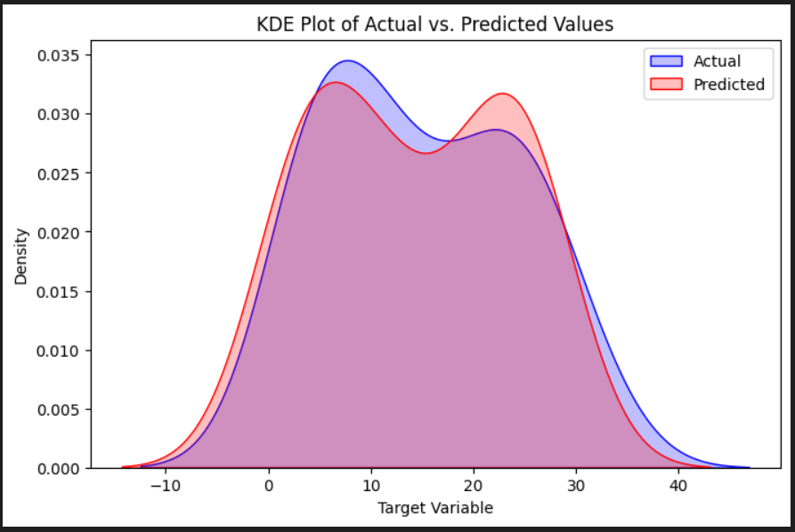

# Gráficos de Estimación de Densidad del Núcleo (KDE) para la Evaluación del Modelo

En el análisis de regresión, evaluar el rendimiento de un modelo no se limita únicamente a medir métricas de error escalar (como MAE o MSE). Una parte fundamental consiste en comparar si la forma, concentración y dispersión de las predicciones reproducen fielmente la distribución real observada.

---

## 1. Conceptos Fundamentales: ¿Qué significan KDE y PDF?

En ciencia de datos y estadística, es común confundir estas siglas con términos de infraestructura o formatos de archivo. Es importante diferenciarlos claramente:

- **PDF no es el formato de documento digital:**
  - En estadística, **PDF** significa **Probability Density Function** (Función de Densidad de Probabilidad). Describe la probabilidad relativa de que una variable continua tome un valor determinado en cualquier punto del espacio numérico.
- **KDE no es Kubernetes:**
  - En analítica de datos, **KDE** significa **Kernel Density Estimation** (Estimación de Densidad del Núcleo o Kernel). Es una técnica estadística no paramétrica que toma puntos de datos discretos y coloca sobre cada uno de ellos una pequeña curva suave ("kernel" o núcleo, típicamente gaussiano), sumándolas todas para aproximar y dibujar la función de densidad continua (PDF).

---

## 2. ¿Por qué utilizar Gráficos KDE en lugar de Histogramas?

Con la desaprobación (*deprecation*) del antiguo método `sns.distplot()` en las versiones modernas de Seaborn, `sns.kdeplot()` se ha consolidado como el estándar oficial de visualización por las siguientes ventajas:

1. **Aproximación suave:** Genera curvas continuas y diferenciables que facilitan la comparación visual directa.
2. **Independencia del ancho de intervalos (*bin width*):** Los histogramas pueden cambiar drásticamente de forma según la cantidad de barras (*bins*) elegida. KDE evita este sesgo y estima una densidad probabilística consistente.
3. **Superposición clara:** Permite graficar múltiples distribuciones simultáneamente con transparencias (`fill=True`), resaltando dónde se solapan y dónde discrepan los valores reales y predichos.
4. **Inspección de colas y asimetría:** Permite evaluar si el modelo subestima valores extremos o sesga la varianza del fenómeno.

---

## 3. Implementación en Python con Scikit-Learn y Seaborn

El siguiente flujo entrena un modelo de regresión lineal sobre datos con ruido estocástico, genera predicciones sobre el conjunto de prueba y grafica ambas densidades con `kdeplot()`:

```python
import numpy as np
import pandas as pd
import seaborn as sns
import matplotlib.pyplot as plt
from sklearn.model_selection import train_test_split
from sklearn.linear_model import LinearRegression
from sklearn.metrics import mean_absolute_error

# 1. Generación de datos sintéticos con ruido aleatorio
np.random.seed(42)
x = np.random.rand(100) * 10
y = 3 * x + np.random.normal(0, 3, 100)  # Relación lineal con componente de ruido
data = pd.DataFrame({'X': x, 'Y': y})

# 2. División de datos en conjuntos de entrenamiento y prueba
X_train, X_test, y_train, y_test = train_test_split(
    data[['X']], data['Y'], test_size=0.2, random_state=42
)

# 3. Entrenamiento del modelo
model = LinearRegression()
model.fit(X_train, y_train)

# 4. Generación de predicciones sobre el conjunto de prueba
y_pred = model.predict(X_test)

# 5. Gráfico de densidades KDE (Valores Reales vs Predichos)
plt.figure(figsize=(8, 5))
sns.kdeplot(y_test, label='Actual', fill=True, color='blue')
sns.kdeplot(y_pred, label='Predicted', fill=True, color='red')
plt.xlabel('Target Variable')
plt.ylabel('Density')
plt.title('KDE Plot of Actual vs. Predicted Values')
plt.legend()
plt.tight_layout()
plt.show()
```

---

## 4. Gráfico Resultante e Interpretación Diagnóstica



Al analizar la curva de valores reales (azul - *Actual*) frente a la curva de valores ajustados (rojo - *Predicted*), se extraen cuatro conclusiones diagnósticas esenciales:

### 1. Solapamiento General entre Distribuciones
Existe un solapamiento significativo en la mayor parte del dominio, lo que demuestra que el modelo capturó la tendencia central y la estructura general de la variable objetivo.

### 2. Desplazamientos de Picos (Modas)
- La curva azul (*Actual*) tiene su pico principal ligeramente más elevado alrededor de $Y \approx 8$, lo que indica una concentración real más densa en ese segmento.
- La curva roja (*Predicted*) desarrolla un segundo pico visible en torno a $Y \approx 23$, sugiriendo que el estimador lineal genera una leve bimodalidad artificial o sobreestima la frecuencia de valores intermedios-altos.

### 3. Dispersión y Varianza
- La distribución real (azul) presenta colas ligeramente más anchas, reflejando la dispersión intrínseca del ruido del mundo real.
- La distribución predicha (roja) es ligeramente más estrecha en los extremos, lo cual es típico de los estimadores lineales, que tienden a "suavizar" la variabilidad extrema.

### 4. Coincidencia en las Colas (Casos Extremos)
Ambas curvas descienden y cierran casi al mismo tiempo en los límites inferiores (alrededor de $-10$) y superiores (alrededor de $45$). Esto certifica que el modelo no está arrojando predicciones descontroladas ni valores atípicos absurdos fuera del rango de datos observados.
